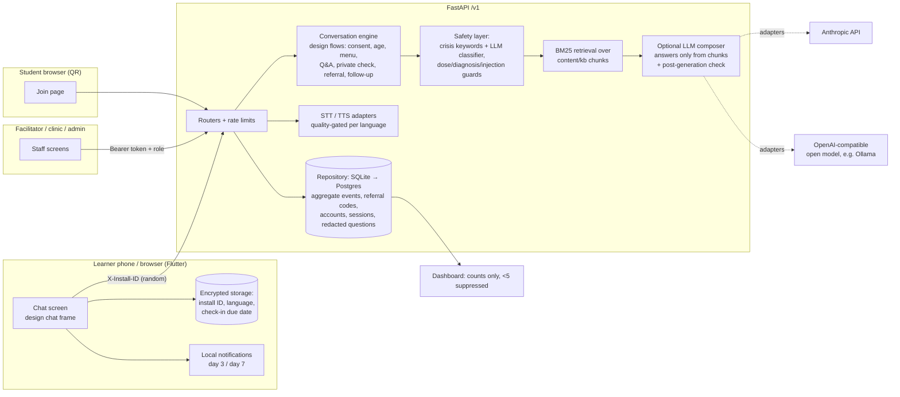

# NextStep (working name)

Open-source tool by **Alamz Tech Ltd** (Nigeria) that helps adolescent girls and young women aged 15–24 move from
"I might be at risk of HIV" to an HIV test or a PrEP visit. HIV prevention only: basic STI questions get general
information and a clinic referral. It **never diagnoses** and **never gives medicine doses**.

> **Status: prototype, built November 2026, not piloted.** All health wording is draft pending clinician review.
> Helplines and services are placeholders; service rows are fake demo data. Nothing here has been tested with real users.

Code: MIT (`LICENSE`). Content: CC BY 4.0 (`content/LICENSE`). Fonts: SIL OFL 1.1.

## What's in the box

| Part | Who uses it | Where |
|---|---|---|
| Learner app (Android + web): a single chat screen built to the design's WhatsApp-style chat frame | young women 15–24, anonymous | `app_flutter/` (served at `/app/`) |
| Student question box (same chat look) | students in a session, via QR code, no install/login | `/app/#/join/<code>` |
| Facilitator screens | teachers, outreach NGOs, CHWs (accounts by org admin) | `/app/#/staff` |
| Partner clinic screen | clinic staff confirm referral codes | `/app/#/staff` → clinic |
| Impact dashboard | platform / org admins, aggregate only | `/dashboard` |
| API | everything above | `/v1/*` (FastAPI) |

## Architecture



The app's chat (`/v1/chat`) and the WhatsApp channel share one conversation engine (`app/engine/engine.py`)
that implements the design's flows and copy. The WhatsApp channel and the original web simulator are **off by
default** (`FEATURE_WHATSAPP=false`, `SIM_ENABLED=false`). Meta's WhatsApp
Business policy bans general-purpose AI chatbots, so if ever enabled it must stay a structured service.

## Live demo

https://nextstep-826530220017.europe-west1.run.app/app/ (fake data, resets on restart). See [docs/DEPLOY.md](docs/DEPLOY.md).

## Run it

```bash
cp .env.example .env        # then set HMAC_SECRET, TOKEN_SECRET, PLATFORM_ADMIN_PASSWORD
scripts/build_web.sh        # needs Flutter; builds app_flutter/build/web
docker compose up --build
```

Open http://localhost:8077/app/ (learner app), http://localhost:8077/dashboard, and API docs at
http://localhost:8077/v1/docs (demo mode only). Seed **clearly fake** demo data for the video:

```bash
docker compose exec api python scripts/seed_demo.py
```

Without Docker (development):

```bash
uv venv -p 3.12 .venv && uv pip install -p .venv -r requirements-dev.txt
scripts/dev.sh                                  # API on :8077
cd app_flutter && flutter run -d chrome --dart-define=API_BASE=http://localhost:8077
```

Tests and red-team report:

```bash
.venv/bin/python -m pytest -q
.venv/bin/python scripts/redteam_report.py      # writes docs/REDTEAM.md
cd app_flutter && flutter test                  # quick exit / PIN / history behaviour
```

## Build the apps

* **Web:** `scripts/build_web.sh` → `app_flutter/build/web`, served by the API at `/app/` (same origin, no CORS).
* **Android APK:** `scripts/build_apk.sh https://your-server` → split APKs per ABI in
  `app_flutter/build/app/outputs/flutter-apk/` (`app-armeabi-v7a-release.apk` is the one for most low-end phones).
  `minSdk` is 24 (Android 7.0, the Flutter 3.47 minimum). For the emulator use `scripts/build_apk.sh http://10.0.2.2:8077`.
  The demo APK is signed with the debug key; create a release keystore before distributing.

## Environment variables

See `.env.example` for the full list. The important ones:

| Variable | Default | Meaning |
|---|---|---|
| `HMAC_SECRET` | dev value (warns) | Hashes install IDs before storage. **Set it.** |
| `TOKEN_SECRET` | derived | Signs staff sign-in tokens. |
| `PLATFORM_ADMIN_USER/PASSWORD` | – | Bootstraps the first platform admin. |
| `PUBLIC_BASE_URL` | `http://localhost:8077` | Used in session QR codes. |
| `DEMO_MODE` | `true` | Shows unverified (tagged) services and draft content; allows seeding. Set `false` for real use: then only `approved` chunks and recently verified services are served. |
| `LLM_PROVIDER` | `none` | `none` · `anthropic` · `openai_compat` |
| `STT_PROVIDER` / `TTS_PROVIDER` | `none` | `openai_compat_http` for a self-hosted Whisper/MMS server |
| `VOICE_APPROVED_LANGS` | empty | Languages whose TTS passed evaluation; others get text only |
| `FEATURE_HAUSA` | `false` | Hausa voice/content flag |
| `QUESTION_TTL_HOURS` | `48` | Question-box text is deleted on session close or after this |
| `REFERRAL_TTL_DAYS` | `90` | Referral codes expire and are deleted |

## Swapping adapters

**LLM.** `app/llm/base.py` defines one method, `complete(system, user, max_tokens, json_schema)`.
* Anthropic (paid; only enable if agreed): `LLM_PROVIDER=anthropic`, `ANTHROPIC_API_KEY`, `ANTHROPIC_MODEL` (default `claude-opus-5-5`, effort `low`).
* Open model: `docker compose --profile openmodel up`, pull a model into Ollama, then `LLM_PROVIDER=openai_compat`,
  `OPENAI_COMPAT_BASE_URL=http://ollama:11434/v1`, `OPENAI_COMPAT_MODEL=<name>`. Any vLLM / llama.cpp server works the same way.
* `LLM_PROVIDER=none` (default) is fully functional: answers are the reviewed chunk text verbatim and crisis detection
  uses the keyword layer only.

**Speech.** `app/voice/base.py`. Point `VOICE_BASE_URL` at any self-hosted server with OpenAI-style
`/audio/transcriptions` and `/audio/speech` endpoints (e.g. faster-whisper for STT; Meta MMS-TTS behind a small
wrapper). Run `scripts/eval_voice.py --lang pcm`, have native speakers listen, then add the language to
`VOICE_APPROVED_LANGS`. Until then the app replies in text and logs an aggregate `voice_fallback` event.

## Content

* `content/copy.json` – design copy (source of truth for wording); `content/copy_extra.json` – engineering additions.
* `content/kb/<lang>/*.md` – knowledge-base chunks with `source_document`, `source_section`, `review_status`.
  **Must be written only from the PDFs in `/sources`** (see `sources/README.md`). Today only 2 chunks have text
  (taken from the design draft, citation TODO); 6 are stubs and are not served.
* `content/check.yaml` – private-check questions and placeholder scoring (replace with a validated tool).
* `data/services.csv` – Lagos referral directory; every row is fake and `verified=false` (see `data/README.md`).
* `config/contacts.yaml` – helplines. **Empty until you verify each number.**

## Docs

[SAFETY.md](SAFETY.md) · [PRIVACY.md](PRIVACY.md) · [docs/DEMO_SCRIPT.md](docs/DEMO_SCRIPT.md) · [docs/REDTEAM.md](docs/REDTEAM.md) · [docs/HANDOFF.md](docs/HANDOFF.md) (design handoff, WhatsApp era)
